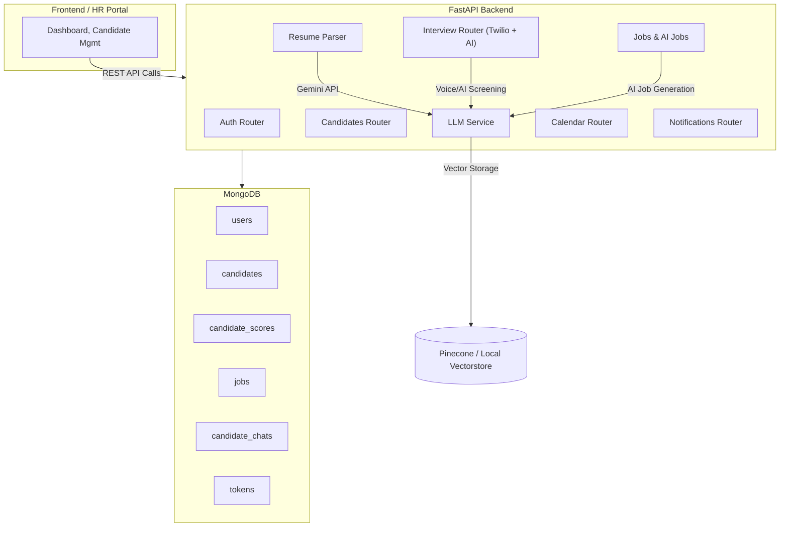

# 01_architecture.md

## 🏗 System Architecture

The **Smart HR Bot** follows a **modular service-oriented architecture** built with **FastAPI** as the backend framework.  
It integrates **AI/LLMs (Gemini via LangChain)**, **MongoDB** for persistence, optional **vector databases** like Pinecone for embeddings, and is **dockerized** for deployment.  

---

## 🔑 Core Components

### 1. **FastAPI Backend**
- Acts as the central **API layer**.  
- Modularized into routers:  
  - **Auth** → Authentication, JWT-based security.  
  - **Users** → HR managers, recruiters, admins.  
  - **Resume** → Resume parsing via Gemini LLM.  
  - **Interview** → Voice-based interviews (Twilio) & AI screening.  
  - **Candidates** → Candidate profiles, scores, and metadata.  
  - **Jobs & AI Jobs** → Job postings, AI-generated job descriptions.  
  - **Calendar & Notifications** → Scheduling & system notifications.  
  - **LLM** → Dedicated endpoints for Gemini/AI queries.  

---

### 2. **Database Layer (MongoDB)**
- Collections:
  - `users` → HR users, recruiters.  
  - `candidates` → Parsed candidate data.  
  - `jobs` → Job descriptions & AI suggestions.  
  - `candidate_scores` → Interview & screening scores.  
  - `candidate_chats` → AI-driven chat transcripts.  
  - `tokens` → Encrypted OAuth/SSO tokens.  
  - `chat_logs` → LLM interactions for debugging & analytics.  
- Token encryption is handled via **Fernet**.  

---

### 3. **LLM & AI Services**
- **Resume Parsing (LangChain + Gemini)** → Extract structured data from raw resumes.  
- **AI Job Description Generation** → Gemini generates job descriptions with structured JSON output.  
- **Interview Simulation**:  
  - Round 1 → **Voice-based interview** (Twilio + speech-to-text + Gemini).  
  - Round 2 → **AI screening** (text-based Q&A).  
- **Scoring Service** → Generates scores for each candidate per round.  
- **Future Plans** → Cheating detection using OpenCV + YOLO + AI/ML.

---

### 4. **Optional Vector Store**
- Default: local vector storage (`./vectorstore`).  
- Future-ready: **Pinecone** or Astra DB for embeddings, enabling:  
  - Semantic resume search.  
  - Candidate-job matching.  
  - Chat memory persistence.  

---

### 5. **Security Layer**
- JWT-based authentication.  
- Token encryption with **Fernet**.  
- Rate-limiting middleware (configurable via settings).  
- Secure environment configuration via `.env`.  

---

### 6. **Logging & Monitoring**
- **Loguru + Python logging** for:  
  - App logs (`logs/app.log`).  
  - LLM raw responses.  
  - Errors & retries (with `tenacity`).  
- Standardized log format with rotation & retention.  

---

### 7. **Dockerization & Deployment**
- **Backend Dockerfile**:
```dockerfile
FROM python:3.11-slim
WORKDIR /app
RUN apt-get update && apt-get install -y --no-install-recommends \
    build-essential gcc git curl pkg-config libcairo2 libpango-1.0-0 libgdk-pixbuf-2.0-0 libmagic1 \
    && rm -rf /var/lib/apt/lists/*
RUN pip install --no-cache-dir --upgrade pip
COPY requirements.txt .
RUN pip install --no-cache-dir -r requirements.txt
COPY . .
EXPOSE 8000
CMD ["uvicorn", "app.main:app", "--host", "0.0.0.0", "--port", "8000", "--reload"]
```
- **Docker Compose**:
```yaml
version: "3.9"
services:
  app:
    build: .
    container_name: smart_hr_bot_app
    restart: always
    env_file: .env
    volumes:
      - .:/app
    ports:
      - "8000:8000"
    networks:
      - smart_hr_network
    dns:
      - 8.8.8.8
      - 8.8.4.4
      - 1.1.1.1
    extra_hosts:
      - "registry-1.docker.io:3.88.79.16"
networks:
  smart_hr_network:
    driver: bridge
```
- Allows **containerized development and deployment**.

---

## 🔄 High-Level Flow



---

## 🚀 Current vs Planned

- ✅ **Implemented**:  
  - Resume parsing  
  - Job generation  
  - Candidate storage & scoring  

- 🔜 **Planned**:  
  - Voice/AI interview pipeline  
  - Calendar & Notifications  
  - Cheating detection (OpenCV + YOLO + AI/ML)  
  - Advanced semantic search with Pinecone  

